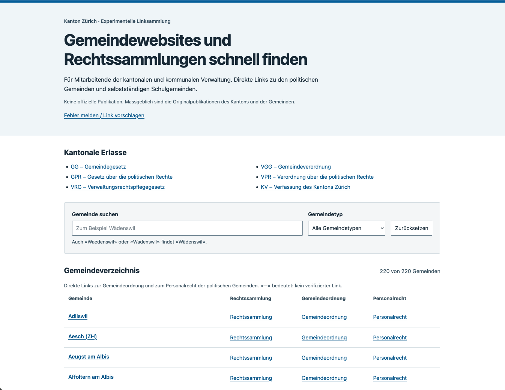

# Gemeindewebsites und Rechtssammlungen im Kanton Zürich

[](https://machinelearningzh.github.io/gemeindeseiten/)

[Gemeindeverzeichnis öffnen](https://machinelearningzh.github.io/gemeindeseiten/)

Für Mitarbeitende der kantonalen und kommunalen Verwaltung: Websites und
Rechtssammlungen von 160 politischen Gemeinden und 60 selbstständigen Schulgemeinden
schnell finden. Suche mit Umlauten oder Umschreibungen, Filter nach Gemeindetyp und
Rückmeldungen per E-Mail über den Link im Kopfbereich.
Zusätzliche Links führen direkt zur Gemeindeordnung und zum Personalrecht der
politischen Gemeinden. «—» bedeutet, dass kein Link verifiziert werden konnte.
Oben stehen Direktlinks zu GG, VGG, GPR, VPR, VRG und KV in der jeweils aktuellen
Fassung der Zürcher Gesetzessammlung (ZH-Lex).

**Experimentelle Linksammlung; keine offizielle Publikation. Massgeblich sind die
Originalpublikationen des Kantons und der Gemeinden.** Kontakt und Pflege: Team Data, Amt für
Statistik und Daten Kanton Zürich, [datashop@statistik.zh.ch](mailto:datashop@statistik.zh.ch).

## Daten und Pflege

Die CSV-Dateien sind die verbindliche Datenquelle für die automatisch erzeugte Seite:

- [Politische Gemeinden](data/municipalities-canton-zurich.csv)
- [Schulgemeinden](data/school-municipalities-canton-zurich.csv)

Grundlage für die Schulgemeinden ist das
[Gemeindeverzeichnis des Gemeindeamts](https://www.zh.ch/content/dam/zhweb/bilder-dokumente/themen/politik-staat/gemeinden/gemeindeverzeichnis.pdf)
mit Stand vom 1. Juli 2026: 24 Primarschul-, 28 Sekundarschul- und 8 Volksschulgemeinden.
Schulen innerhalb einer politischen Gemeinde sind nicht zusätzlich aufgeführt.
Adressen wurden über das [kantonale Schuladressenverzeichnis](https://www.zh.ch/de/bildung/schulen.html)
und die Websites der Schulen recherchiert.

Die Website nennt die manuellen Prüfstände unter «Quellen und Prüfstand».
[Wöchentliche HTTP-Prüfberichte](https://github.com/machinelearningZH/gemeindeseiten/actions/workflows/check-links.yml)
zeigen erreichbare Links, blockierte Prüfungen und Prüfbedarf. Sie bestätigen keine
inhaltliche oder rechtliche Aktualität und ändern weder Daten noch Website.

## Entwicklung und Veröffentlichung

Voraussetzungen: Python ab 3.13, uv, Make und Node.js für die JavaScript-Tests.
Die Befehle im Repository-Verzeichnis ausführen:

```sh
uv sync --locked
uv run build-site
make check
```

Der Build erzeugt die statische Seite und beide CSV-Downloads in `_site/` aus
`data/` und `web/`. Suche und Filter laufen im Browser; ohne JavaScript bleibt die
gesamte Liste sichtbar.

Der [Pages-Workflow](.github/workflows/pages.yml) veröffentlicht `_site/` bei
relevanten Änderungen auf `main` oder nach manuellem Start auf `main`.
Änderungen nur an Markdown-Dokumentation lösen keine Veröffentlichung aus.
Die erzeugten Dateien werden nicht eingecheckt.

Details zu Datenpflege, Linkprüfung und Veröffentlichung:
[Wartung](docs/maintenance.md). Besondere Prüfhinweise stehen in [NOTES.md](NOTES.md),
offene Entscheidungen in [PLAN.md](PLAN.md).
